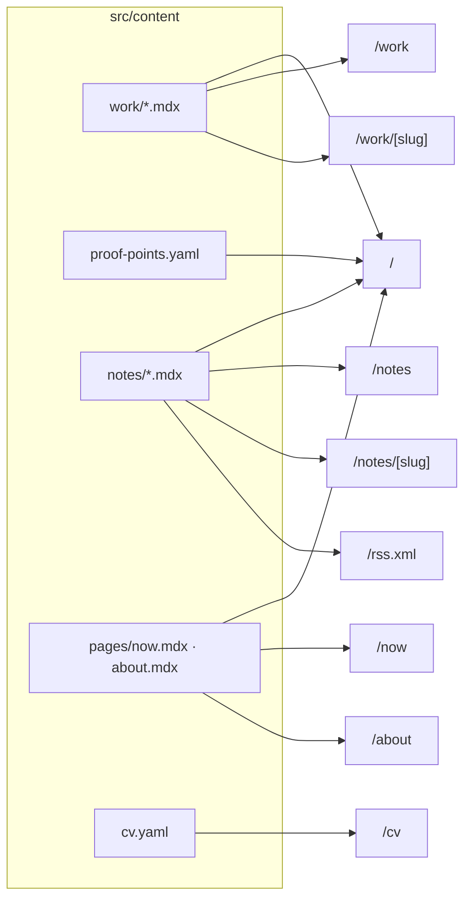

# mattias-portfolio: architecture spec (v1)

> **For Claude Code.** Scope: scaffold the repo, content plumbing, routes, layouts and empty components.
> **Do not write copy or choose the final visual design.** Mattias owns both. Put `TODO(mattias)` wherever words or design values go.

Versions checked 20 Oct 2026: `astro` 7.4 · `@astrojs/mdx` 8.1 · `@astrojs/sitemap` 3.7 · `@astrojs/rss` 4.0 · `tailwindcss` / `@tailwindcss/vite` 4.3 · Node ≥ 22.22.
Install `@latest`. If a major version has moved since then, follow its docs over this file.

---

## 1. Decisions

| Area | Choice | Reason |
|---|---|---|
| Framework | **Astro**, static output (SSG) | About 8 content pages. Zero client JS by default. Typed content collections fit the fixed story format |
| UI framework | **None at scaffold time** | No interactive demos are planned. Add `@astrojs/react` only once a component needs client state |
| Content | MDX + YAML in `src/content/`, Zod-validated collections | Stories live in git, and a malformed story fails the build |
| Styling | Tailwind v4 (`@tailwindcss/vite`) + design tokens as CSS variables | Tokens are the single source of truth, and utilities read them |
| Fonts | Astro Fonts API (`fonts` in config) | Self-hosted and preloaded. Inter (variable, 300–600, with its optical-size axis) sets body and display text, picked by Mattias; the headline is Inter Light at its display cut. JetBrains Mono for code |
| Code blocks | Shiki (built in), light/dark pair | Used by notes |
| Hosting | Vercel, static, **no adapter** | Pushes deploy previews; `main` deploys to production |
| Package manager | npm | Swap for pnpm if preferred |

---

## 2. Routes

| Route | Data source | Notes |
|---|---|---|
| `/` | `work` (by `order`), `proof`, `pages/now`, `notes` (latest 3) | Sections in order: Intro · Selected work · Platform proof points · Now · Notes. A section with no data is not rendered |
| `/work` | `work` | All published case studies, by `order` |
| `/work/[slug]` | `work/<slug>.mdx` | `CaseStudyLayout` |
| `/notes` | `notes` | Newest first, grouped by year |
| `/notes/[slug]` | `notes/<slug>.mdx` | `ProseLayout` |
| `/now` | `pages/now.mdx` | Must show the `updated` date (required for this entry) |
| `/about` | `pages/about.mdx` | `ProseLayout` |
| `/cv` | `cv` + `public/cv.pdf` | HTML CV plus a PDF download link. Print stylesheet hides header and footer |
| `/rss.xml` | `notes` | `@astrojs/rss` |
| `/404` | n/a | |
| `/sitemap-index.xml` | auto | `@astrojs/sitemap` |



---

## 3. Repo layout

```
mattias-portfolio/
├─ _private/                     # gitignored. CV .docx sources live here
├─ public/
│  ├─ cv.pdf
│  ├─ favicon.svg                # placeholder
│  ├─ og/default.png             # placeholder 1200×630
│  └─ robots.txt
├─ src/
│  ├─ assets/work/<slug>/        # mock-data screenshots and diagrams, one folder per case study
│  ├─ components/
│  │  ├─ site/    Header.astro · Footer.astro · Nav.astro · Seo.astro · ThemeToggle.astro · SkipLink.astro · Arrow.astro
│  │  ├─ apron/   RadarBand.astro · Terminal.astro · TerminalDive.astro · StandArt.astro · Stand.astro
│  │  ├─ work/    WorkCard.astro · SummaryCard.astro · MetricList.astro · BeatNav.astro · ProofPoints.astro · Pager.astro
│  │  ├─ notes/   NoteItem.astro
│  │  └─ mdx/     Figure.astro · Metric.astro · Decision.astro · Aside.astro · index.ts
│  ├─ config/site.ts             # name, url, nav, socials (TODO values)
│  ├─ content/
│  │  ├─ work/ai-data-import.mdx
│  │  ├─ work/intelligence-center.mdx
│  │  ├─ notes/_example.mdx      # underscore = excluded by the loader
│  │  ├─ pages/about.mdx
│  │  ├─ pages/now.mdx
│  │  ├─ proof-points.yaml
│  │  └─ cv.yaml
│  ├─ content.config.ts
│  ├─ layouts/   BaseLayout.astro · ProseLayout.astro · CaseStudyLayout.astro
│  ├─ lib/       beats.ts · content.ts · format.ts · remark-reading-time.mjs · apron/ (planes.ts · radar.ts · terminal.ts)
│  ├─ pages/
│  │  ├─ index.astro
│  │  ├─ work/index.astro · work/[slug].astro
│  │  ├─ notes/index.astro · notes/[slug].astro
│  │  ├─ about.astro · now.astro · cv.astro · 404.astro
│  │  └─ rss.xml.ts
│  └─ styles/    global.css · tokens.css · prose.css · print.css
├─ .github/workflows/ci.yml
├─ astro.config.mjs
├─ tsconfig.json
├─ .nvmrc · .prettierrc · .gitignore
├─ CLAUDE.md
└─ SPEC.md
```

---

## 4. Content model

### `src/content.config.ts`

```ts
import { defineCollection } from 'astro:content';
import { glob, file } from 'astro/loaders';
import { z } from 'astro/zod';

const metric = z.object({
  label: z.string(),               // e.g. "Time to first words"
  before: z.string().optional(),   // e.g. "27.3s"
  after: z.string(),               // e.g. "12.9s"
  note: z.string().optional(),
});

const work = defineCollection({
  loader: glob({ base: './src/content/work', pattern: '**/[^_]*.mdx' }),
  schema: ({ image }) =>
    z.object({
      title: z.string(),
      summary: z.string().max(200),          // card one-liner
      tldr: z.string().optional(),           // the 30-second version
      order: z.number().int(),
      org: z.string(),                       // e.g. "RingIT · GAIA"
      role: z.string(),
      period: z.object({ start: z.coerce.date(), end: z.coerce.date().optional() }),
      stack: z.array(z.string()).default([]),
      metrics: z.array(metric).max(4).default([]),
      cover: image().optional(),
      coverAlt: z.string().optional(),
      disclosure: z.enum(['mock-data']).optional(), // renders the mock-data notice on the page
      draft: z.boolean().default(false),
    }).refine((d) => !d.cover || !!d.coverAlt, { message: 'coverAlt is required when cover is set' }),
});

const proof = defineCollection({
  loader: file('src/content/proof-points.yaml'),
  schema: z.object({
    id: z.string(),
    title: z.string(),
    detail: z.string(),                      // one line
    year: z.number().int(),
    metric: z.string().optional(),
    order: z.number().int(),
    hidden: z.boolean().default(false),
  }),
});

const notes = defineCollection({
  loader: glob({ base: './src/content/notes', pattern: '**/[^_]*.mdx' }),
  schema: z.object({
    title: z.string(),
    description: z.string(),
    published: z.coerce.date(),
    updated: z.coerce.date().optional(),
    tags: z.array(z.string()).default([]),
    draft: z.boolean().default(false),
  }),
});

const pages = defineCollection({
  loader: glob({ base: './src/content/pages', pattern: '*.mdx' }),
  schema: z.object({
    title: z.string(),
    description: z.string(),
    updated: z.coerce.date().optional(),     // required for `now`, enforced in now.astro
  }),
});

const cv = defineCollection({
  loader: file('src/content/cv.yaml'),
  schema: z.object({
    id: z.string(),
    section: z.enum(['experience', 'education', 'skills']),
    title: z.string(),
    org: z.string().optional(),
    location: z.string().optional(),
    start: z.string().optional(),            // "2024-12"
    end: z.string().optional(),              // omit = present
    bullets: z.array(z.string()).default([]),
    order: z.number().int(),
  }),
});

export const collections = { work, proof, notes, pages, cv };
```

### `src/lib/content.ts`

- `getPublished(name)` returns all entries in dev and drops `draft: true` (and `hidden: true` for `proof`) in production (`import.meta.env.PROD`).
- Sorters: `byOrder`, `byPublishedDesc`. `getAdjacentWork(id)` returns `{ prev, next }` by `order` among published entries.

### Story format (`work`)

The body of every case study uses **exactly these H2s, in this order**:

`Problem` → `Constraints` → `Approach` → `Decisions` → `When it broke` → `Next`

- `src/lib/beats.ts` exports `BEATS` (`{ label, slug }[]`) and `assertBeats(headings, id)`.
- `/work/[slug]` passes `headings` from `render(entry)` to `assertBeats`. In a production build a missing, extra or out-of-order H2 throws an error naming the file and the beat. In dev it calls `console.warn`.
- H3s inside a beat are allowed. Other H2s are not.
- The summary card is built from frontmatter, never from the body.
- Read time comes from `src/lib/remark-reading-time.mjs` (`reading-time` + `mdast-util-to-string`), exposed as `remarkPluginFrontmatter.minutesRead`, and is shown on `WorkCard` and the page header. The target is about 3 minutes.

### MDX components

They are passed with `<Content components={mdxComponents} />` (from `components/mdx/index.ts`), so MDX files don't import components. MDX files only import their own images.

| Component | Props | Purpose |
|---|---|---|
| `Figure` | `src: ImageMetadata`, `alt: string` (required), `caption?`, `mock?: boolean` | Wraps `<Image>` from `astro:assets`. `mock` adds a small "mock data" label (wording `TODO(mattias)`) |
| `Metric` | `label`, `before?`, `after`, `note?` | Inline before → after figure |
| `Decision` | `title`, `options: string[]`, `chose: string`, children = rationale | For the Decisions beat |
| `Aside` | children | Side note, visually secondary |

---

## 5. Layouts and components

**Layouts**

- `BaseLayout` has props `{ title, description, ogImage?, noindex? }`. It renders `<html lang="en">`, `Seo`, `<Font>` tags, the inline theme-init script, `SkipLink`, `Header`, `<main id="main">`, `Footer`.
- `ProseLayout` = Base + title + optional updated date + `.prose` wrapper. Used by about, now and notes.
- `CaseStudyLayout` = Base + `SummaryCard` (title, org, role, period, stack, metrics, read time, tldr) + `BeatNav` + `.prose` body + mock-data notice when `disclosure` is set + `Pager`.

**Components**

- Every component has a typed `Props` interface, no hard-coded copy (labels come from props or `site.ts`), and uses token-backed Tailwind classes only (no raw hex values).
- `BeatNav` is generated from `BEATS`, sticky on wide screens and a horizontal scroll row on narrow ones. It highlights the active beat.
- `WorkCard` shows title, summary, org, period, read time and up to 2 metrics.
- `ProofPoints` is a compact list: title, detail, year, optional metric.
- The home hero is the name and role in clear air with a storm all around: `introTitle` from `site.ts`, its last words (`introTitleRole`) on their own line with halation (the ink stays dark and orange bleeds off the letters' edges), then a one-line `intro` and a link down to Selected work. The hero fills the first screen, and `RadarBand` fills it behind them, full bleed: the storm runs off the top and both sides and thins out just below the fold. The header leaves out the name on the home page, since the headline is the name.
- `Terminal` is the home page's Selected work: one apron scene drawn at build time (`lib/apron/terminal.ts`, same camera as the planes). Each case study's plane parks nose-in along a plain terminal pier on a bare apron (no stand markings or jet bridges), with its glass gate sign (number and title) just past its tail; a control tower behind the last stands turns its radar antenna. Hovering or focusing a plane or its sign lights the stand and drops a small peek under the sign (org and dates, the summary, the first metric), anchor-positioned so it stays on screen. On phones the whole scene fits the screen, the signs show only their numbers, and a numbered list of the projects follows it. Clicking hands off to the case study: the plane flies into its `SummaryCard` stand while the rest fades (`TerminalDive`, a view transition). All of it is CSS: no client JS.

**Client JS budget.** These are the only scripts allowed, all as vanilla `<script>` in `.astro` files:

1. Theme init: inline in `<head>`, under 1 KB, sets `data-theme` before paint. Wrap the `localStorage` read/write in try/catch.
2. `ThemeToggle`
3. `BeatNav` active-section highlight (IntersectionObserver)
4. `RadarBand`: paints the storm behind the home hero on a canvas at device resolution, in 9px cells on every screen, drifts it along its line (held still under reduced motion), frays it around each line of the hero's words (`clearAir` in `lib/apron/radar.ts`: a wandering edge and a fringe that thins out cell by cell, never a straight edge) and warms the cells under the mouse. Without JS the start of the drift shows as an SVG band along the hero's foot.

---

## 6. Styling

- **`tokens.css`** holds every design value as a CSS variable. All values are placeholders marked `TODO(mattias)`:
  - Color, semantic names only: `bg`, `surface`, `text`, `muted`, `border`, `accent`, `accent-contrast`
  - Type scale `xs → 3xl`, line heights, `--measure` (prose width, about 65ch)
  - Spacing rhythm, radius, motion (`--ease`, `--dur-fast`, `--dur-base`)
- **`global.css`**:
  ```css
  @import "tailwindcss";
  @import "./tokens.css";
  @import "./prose.css";
  @import "./print.css";
  @custom-variant dark (&:where([data-theme=dark], [data-theme=dark] *));
  ```
  - In `tokens.css`, define colors inside `@theme { --color-*: initial; --color-bg: …; }`, which removes Tailwind's default palette so only tokens exist. Override the same variables under `[data-theme="dark"]`, with a `@media (prefers-color-scheme: dark) { :root:not([data-theme]) { … } }` fallback for no-JS.
  - Fonts: the Fonts API sets `--font-body` and `--font-code`. Map them with `@theme inline { --font-sans: var(--font-body); --font-mono: var(--font-code); --font-display: var(--font-body); }`.
- **`prose.css`** styles MDX output (h2, h3, p, lists, blockquote, code, pre, figure, table) with tokens. Don't use `@tailwindcss/typography`. Include the Shiki dual-theme switch on `[data-theme=dark]`.
- **`print.css`** hides header, footer and theme toggle and sets black-on-white text. Used mainly by `/cv`.
- Respect `prefers-reduced-motion`. Visible focus styles on every interactive element.

---

## 7. Config

**`astro.config.mjs`**

```js
import { defineConfig, fontProviders } from 'astro/config';
import mdx from '@astrojs/mdx';
import sitemap from '@astrojs/sitemap';
import tailwindcss from '@tailwindcss/vite';
import { remarkReadingTime } from './src/lib/remark-reading-time.mjs';

export default defineConfig({
  site: 'https://example.com', // TODO(mattias): final domain (sitemap, RSS and canonical URLs depend on it)
  integrations: [mdx(), sitemap()],
  markdown: {
    remarkPlugins: [remarkReadingTime],
    shikiConfig: { themes: { light: 'github-light', dark: 'github-dark' } },
  },
  fonts: [
    // TODO(mattias): placeholder families
    { provider: fontProviders.fontsource(), name: 'Inter', cssVariable: '--font-body' },
    { provider: fontProviders.fontsource(), name: 'JetBrains Mono', cssVariable: '--font-code' },
  ],
  vite: { plugins: [tailwindcss()] },
});
```

**`tsconfig.json`**: extends `astro/tsconfigs/strict`, `"paths": { "@/*": ["src/*"] }`, includes `.astro/types.d.ts`.

**`package.json` scripts**

```json
{
  "dev": "astro dev",
  "check": "astro check",
  "build": "astro check && astro build",
  "preview": "astro preview",
  "format": "prettier --write ."
}
```

- **Dependencies:** `astro`, `@astrojs/mdx`, `@astrojs/sitemap`, `@astrojs/rss`, `tailwindcss`, `@tailwindcss/vite`, `reading-time`, `mdast-util-to-string`.
- **Dev dependencies:** `@astrojs/check`, `typescript`, `prettier`, `prettier-plugin-astro`, `prettier-plugin-tailwindcss`.
- **Nothing else** without asking.

**`.nvmrc`**: `24` · **`engines.node`**: `>=22.22`

**`.gitignore`**: `node_modules/`, `dist/`, `.astro/`, `.vercel/`, `.env*`, `.DS_Store`, `_private/`

**`src/config/site.ts`**: `name`, `url`, `description` (TODO), `email` (TODO), `socials` (GitHub and LinkedIn, TODO hrefs), `nav` (Work · Notes · Now · About · CV).

**SEO (`Seo.astro`)**: title template `"%s · <name>"`, description, canonical, OG and Twitter tags (`og/default.png` fallback), `noindex` support, JSON-LD `Person` on `/` only.

---

## 8. Build order

Commit after each step.

0. **Prep the folder.** It already holds CV files, so don't run `npm create astro` here. Write the files by hand.
   - `git init`
   - `mkdir _private` and move both `.docx` CVs into it with `mv -n`
   - Ask Mattias to confirm that `Curriculum Vitae Mattias Puhk.pdf` is the public version, then copy it to `public/cv.pdf`
1. **Tooling:** `package.json`, deps, `tsconfig.json`, `astro.config.mjs`, `.nvmrc`, Prettier, `.gitignore`. Done when `npm run dev` serves a blank page.
2. **Styles:** `tokens.css`, `global.css`, `prose.css`, `print.css`, theme-init script, `ThemeToggle`.
3. **Content:** `content.config.ts`, `lib/content.ts`, `lib/beats.ts`, the remark plugin, seed files (§9).
4. **Layouts and components (§5).** Every list gets an empty state that renders nothing.
5. **Pages (§2).**
6. **SEO:** `Seo.astro`, sitemap, `robots.txt`, RSS, JSON-LD, placeholder OG image and favicon.
7. **CI:** `.github/workflows/ci.yml` runs `npm ci` → `npm run build` on push and PR (Node from `.nvmrc`). On Vercel, use the Astro preset with output `dist`.
8. **Write `CLAUDE.md`** (§11).

---

## 9. Seed content (structure only, no prose)

- `work/ai-data-import.mdx`: `order: 1`, `draft: true`, `disclosure: mock-data`, `org: "RingIT · GAIA"`, the six beat H2s, each followed by `{/* TODO(mattias) */}`.
- `work/intelligence-center.mdx`: same, with `order: 2`.
- `proof-points.yaml`: four entries with `detail: "TODO(mattias)"`:
  1. `org-identity`: Unified organisation identity
  2. `cloud-tasks`: Email jobs moved from BullMQ to Cloud Tasks
  3. `nestjs-migration`: NestJS migration
  4. `design-system`: Design system and virtualised DataTable
- `pages/now.mdx` and `pages/about.mdx`: frontmatter and a TODO body. `now` has `updated` set.
- `notes/_example.mdx`: excluded by the glob. Documents the frontmatter for future notes.
- `cv.yaml`: one example entry per section, all values TODO.

---

## 10. Disclosure guardrails (GAIA)

- Screenshots show **mock data only** and go through `<Figure mock>`.
- These never go in the repo: GAIA source code, database schema, customer or partner names, commission or pricing logic, backend internals.
- Only publish numbers Mattias has cleared.

---

## 11. `CLAUDE.md` to create

```md
# mattias-portfolio
Static Astro site. SPEC.md is the source of truth. Read it before structural changes.

Rules
- Never write copy (headlines, bios, story text). Leave `TODO(mattias)`.
- Don't change token values, fonts or the visual design. Mattias owns design.
- No client JS beyond theme init, ThemeToggle, BeatNav and RadarBand. No new dependencies without asking.
- GAIA: mock-data screenshots only. No source, schema, customer names, or pricing/commission logic.
- Case studies keep the six H2 beats in order (see src/lib/beats.ts).
- Before committing: `npm run build` must pass.
```

---

## 12. Acceptance criteria

- [ ] `npm run build` passes with zero `astro check` errors while all seeds are drafts.
- [ ] Publishing a case study (`draft: false`) with one beat removed makes the build fail, naming the file and the beat.
- [ ] The built HTML for `/` and `/work/<slug>` contains no scripts except the three in §5.
- [ ] Lighthouse mobile scores ≥ 95 in all four categories on `/` and a case study.
- [ ] Without JS, pages render and the theme follows the system setting.
- [ ] Light and dark modes are both correct, including code blocks.
- [ ] Skip link works, focus is visible, and the whole site can be used by keyboard.
- [ ] `/cv` prints cleanly (no header, footer or toggle).
- [ ] `Figure` without `alt` is a type error.
- [ ] `/sitemap-index.xml`, `/rss.xml` and `/robots.txt` resolve.

---

## 13. Later (not in the scaffold)

Generated OG images (satori) · view transitions (`<ClientRouter />`) · Vercel Web Analytics · React islands · custom domain
